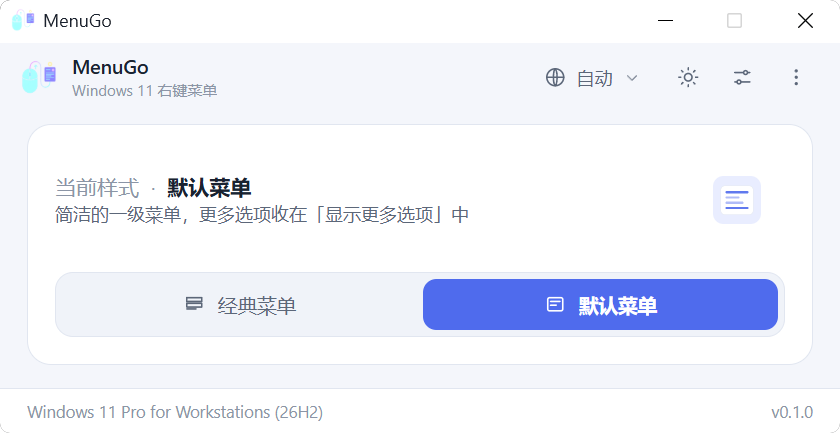
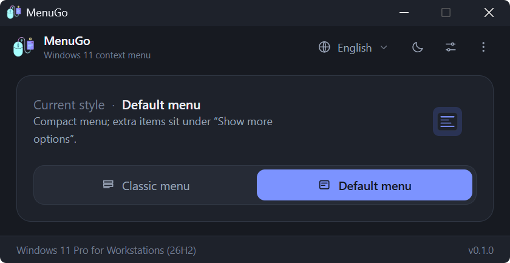

<div align="center">


# MenuGo

**One click to switch between the classic and the default Windows 11 right-click context menu.**

[](LICENSE)
[](https://www.microsoft.com/windows/windows-11)
[](https://tauri.app)
[](https://www.rust-lang.org)
[](src)
[](https://github.com/zlingxi/MenuGo/releases/latest)

**English** | [简体中文](docs/README.zh-CN.md) | [繁體中文](docs/README.zh-TW.md) | [日本語](docs/README.ja.md) | [한국어](docs/README.ko.md)

</div>

## Screenshots

| Light | Dark |
| --- | --- |
|  |  |

## Why MenuGo?

Ever since Windows 11 shipped with its new context menu, the web has been full of
tutorials on bringing the old, information-dense (Win10-style) menu back: hand-edit
the registry in `regedit`, paste a `.reg` snippet from a random blog, or install a
heavy "tweaking suite" where you can't tell what else it touches. What has never
been easy to answer is the simple question: *is there a proper little app that just
does this?*

MenuGo is that app. I originally wrote it for my own daily use — a **tiny**, **free**
and **open-source** utility that does exactly one thing: switch the Windows 11
right-click menu between **classic** and **default** in one click, restart Explorer
so the change takes effect, and stay out of your way. It worked so well for me that
I decided to polish it and share it with everyone: **completely free, no ads, no
tracking, with the full source code in the open.**

## Highlights

- 🖱️ **One-click toggle** between the classic (Win10-style) and default Win11 context menu — the current state *is* the switch, no confirmation popups
- 🖥️ **Opens where your mouse is** — the window launches centered on the monitor the cursor is in, not always the primary one
- 🧹 **Built-in Clear Cache** — one click wipes MenuGo settings plus WebView cache from your user profile; locked leftovers are swept automatically on the next launch
- 🔁 **Built-in Explorer restart**: ends the shell, waits for Winlogon to restore it first, only launches `%WINDIR%\explorer.exe` as a fallback, and verifies the desktop (`Shell_TrayWnd`) is really back before claiming success
- 👥 **Apply to all users** (optional, needs administrator rights)
- 🪶 **Tiny footprint**: native Rust backend + vanilla JS frontend (no bundler, no framework), packaged with Tauri 2 — the exe is only a few MB, and it uses the WebView2 that already ships with Windows 11
- 🌍 **10 interface languages** with auto-detection: English, 简体中文, 繁體中文, 日本語, 한국어, Deutsch, Français, Español, Русский, Türkçe
- 🌓 Light / dark / follow-system theme, with the **native title bar color synced** via DWM
- 🧳 **Portable mode**: drop an empty `portable.flag` next to the exe and settings are kept in a `settings.ini` beside it (instead of `%APPDATA%\MenuGo`)
- ⌨️ **Command line support** for scripts and automation (`MenuGo.exe /C /R`)
- 🧭 Boundary states are built into the UI: not elevated, not Windows 11, taskbar-always-on-top unsupported — you see it, instead of decoding error popups

## Download

Grab the latest build from the [**Releases**](https://github.com/zlingxi/MenuGo/releases) page and run it — no installer dance, no dependencies to install.

## Usage

1. Launch MenuGo. It shows the currently active menu style.
2. Click **Classic** or **Default** to switch. A "restart pending" bar appears.
3. Click **Restart Explorer** on the bar — or turn on *auto-restart after switching* in the quick-settings overlay and never think about it again.

Secondary options (apply to all users, auto-hide taskbar, taskbar always on top, appearance, language, clear cache) live in the overlay behind the top-right button; command line help and About, plus the GitHub / Blog / Donate links, live in the ⋮ (More) menu at the top right.

### Keyboard shortcuts

| Key | Action |
| --- | --- |
| `F5` | Refresh status |
| `F1` | About |
| `Esc` | Close overlay |
| `Alt+C` / `Alt+D` | Switch to classic / default |

### Command line

```bat
MenuGo.exe /C     :: switch to the classic menu
MenuGo.exe /D     :: switch to the default menu
MenuGo.exe /R     :: restart Explorer (exit code 1 on failure)
MenuGo.exe /?     :: help
```

Combine them: `MenuGo.exe /C /R` switches to classic and restarts Explorer in one go.

## How it works

No magic — the whole tool boils down to these registry operations, so you can verify everything yourself:

| Action | Registry |
| --- | --- |
| Classic menu | create `HKCU\Software\Classes\CLSID\{86ca1aa0-34aa-4e8b-a509-50c905bae2a2}\InprocServer32` with an empty default `REG_SZ` value |
| Default menu | delete the CLSID key above |
| All users | the same operation under `HKEY_USERS\<SID>\Software\Classes\CLSID\...` (requires elevation) |
| Taskbar | `HKCU\...\Explorer\StuckRects3\Settings` (`REG_BINARY`, byte 8 = auto-hide, byte 12 = position) |
| Version check | Windows 11 = `CurrentBuild >= 22000` (`ProductName` still says "Windows 10" on Win11, so it is not used) |

> Note: the taskbar position option only works on early Windows 11 builds — Microsoft
> removed that capability in later ones. It is kept for compatibility with older builds.

## Build from source

Requirements: Node.js, the Rust toolchain (`stable-msvc`), Windows 11.

```bash
npm install
npm run dev      # development (tauri dev)
npm run build    # production build (tauri build)
```

You can also preview the UI in a regular browser by opening `src/index.html` directly (frontend only, sample data, no backend).

## Project layout

```
src/                        Frontend (native ESM, no bundler)
  index.html                Window markup + inline SVG icons
  styles.css                Light/dark/system themes, cards, overlays, switches
  main.js                   State orchestration and event binding
  modules/api.js            Tauri IPC wrapper + external-link constants
  modules/i18n.js           Language dictionary + locale resolution
  modules/ui.js             Rendering / theme / overlays / dialogs
src-tauri/
  src/main.rs               CLI dispatch (/C /D /R /?, windowless)
  src/lib.rs                AppState + Builder
  src/cli.rs                CLI parsing
  src/commands.rs           All #[tauri::command] handlers
  src/registry.rs           Registry read/write (single access point)
  src/system.rs             Explorer restart / shell open / elevation check
  src/cleanup.rs            User-profile cleanup (settings + WebView cache)
  src/shell.rs              Taskbar window probing (user32 FFI, restart verification)
  src/titlebar.rs           DWM title-bar coloring (dwmapi FFI)
  src/config.rs             INI settings persistence
  src/models.rs             DTOs
  tauri.conf.json           Fixed 560x300 window (resizable / maximizable = false)
  capabilities/default.json Permissions
```

## Notes

- Windows 11 (build ≥ 22000) only; other versions get a friendly notice.
- "Apply to all users" writes to `HKEY_USERS` and requires running MenuGo as administrator.
- MenuGo touches only the registry keys listed in [How it works](#how-it-works) — nothing else.

## Contributing

Bug reports, feature ideas and pull requests are welcome! If you speak one of the
interface languages and spot an awkward translation, fixing it in
`src/modules/i18n.js` (or in the matching `docs/README.*.md`) is a great first PR.

## License

Copyright © 2026 lingxi

This project is licensed under the [**GNU General Public License v3.0**](LICENSE) (GPL-3.0).

What that means for you, in plain words:

- ✅ **Free to use** for any purpose, personal or commercial
- ✅ **Free to study and modify** — the complete source is right here
- ✅ **Free to redistribute** the original or your modified version
- 📌 If you distribute a modified version — or anything built on this code — please release it under **GPL-3.0 with the complete source code**, so others can enjoy the same freedoms you did. Thank you for keeping the chain open!
- 📌 Please **keep the original copyright notice and attribution**, and mention what you changed. Giving credit where it is due is a small gesture that means a lot to open-source authors. 💙

The full legal text is in [LICENSE](LICENSE).

## Author

MenuGo is developed by **lingxi** — [Blog](https://www.aizzx.top) · [Donate ❤](https://www.aizzx.top/sponsor)

If MenuGo saves you a few clicks every day, a star ⭐ on this repository is the best encouragement!
