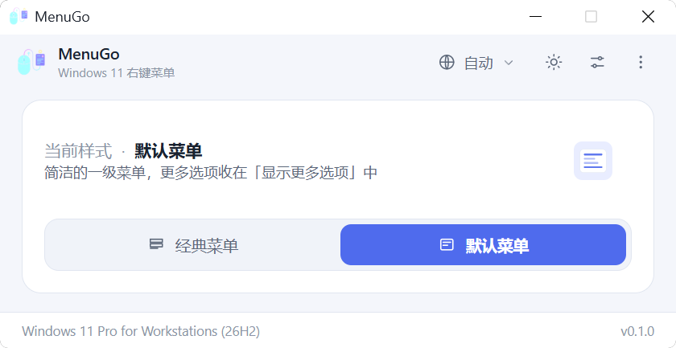
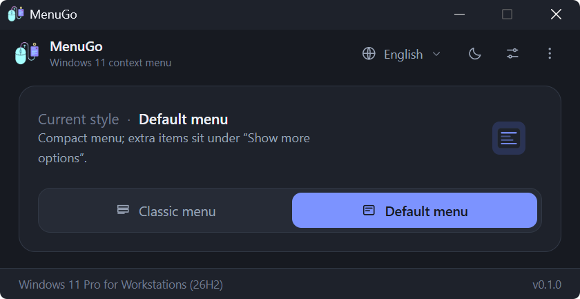

<div align="center">


# MenuGo

**ワンクリックで、Windows 11 の右クリックメニューをクラシックと既定の間で切り替えます。**

[](../LICENSE)
[](https://www.microsoft.com/windows/windows-11)
[](https://tauri.app)
[](https://www.rust-lang.org)
[](../src)
[](https://github.com/zlingxi/MenuGo/releases/latest)
[](https://github.com/zlingxi/MenuGo/stargazers)
[](https://github.com/zlingxi/MenuGo/releases)

[English](../README.md) | [简体中文](README.zh-CN.md) | [繁體中文](README.zh-TW.md) | **日本語** | [한국어](README.ko.md)

</div>

## スクリーンショット

| ライト | ダーク |
| --- | --- |
|  |  |

## なぜ MenuGo なのか？

Windows 11 に新しい右クリックメニューが搭載されて以来、ネット上には昔の情報量の多い（Win10 風）メニューを復活させるチュートリアルがあふれています。`regedit` でレジストリを手動編集する、どこかのブログから拾ってきた `.reg` を貼り付ける、あるいは何に手を染めたのか分からない巨大な「カスタマイズツール」をインストールする——。それでも、シンプルな問いに答えてくれるものはありませんでした。*「これだけをしてくれる、ちゃんとした小さなアプリはないのか？」と。*

MenuGo はまさにそのアプリです。もともとは私自身の日常使いのために書いたもの——**小さく**、**無料**で**オープンソース**のユーティリティで、ただ一つのことだけを行います。Windows 11 の右クリックメニューを**クラシック**と**既定**の間でワンクリックで切り替え、変更を反映するためにエクスプローラーを再起動し、あとは静かに身を引きます。あまりに快適だったので、磨き上げてみなさんに公開することにしました。**完全無料、広告なし、トラッキングなし、ソースコードは全公開です。**

## 主な特徴

- 🖱️ クラシック（Win10 風）と既定の Win11 右クリックメニューを**ワンクリックで切り替え** — 現在の状態が*そのまま*スイッチになり、確認ダイアログは出ません
- 🖥️ **マウスのある画面で起動**——ウィンドウはカーソルがあるモニターの中央に開き、常にメイン画面で開くわけではありません
- 🧹 **キャッシュクリア内蔵**——ユーザーディレクトリ内の設定・キャッシュファイルをワンクリックで削除。使用中のファイルは次回起動時に自動的に削除されます
- 🔁 **エクスプローラーの再起動を内蔵**：シェルを終了した後、まず Winlogon による復元を待ち、復元されなかった場合にのみ `%WINDIR%\explorer.exe` をフォールバックとして起動し、成功と宣言する前にデスクトップ（`Shell_TrayWnd`）が本当に戻ったことを検証します
- 👥 **すべてのユーザーに適用**（任意、管理者権限が必要）
- 🪶 **軽量フットプリント**：ネイティブ Rust バックエンド + バニラ JS フロントエンド（バンドラーなし、フレームワークなし）、Tauri 2 でパッケージング — exe はわずか数 MB で、Windows 11 に最初から同梱されている WebView2 を使用します
- 🌍 **10 種類のインターフェース言語**、自動検出対応：English、简体中文、繁體中文、日本語、한국어、Deutsch、Français、Español、Русский、Türkçe
- 🌓 ライト / ダーク / システムに従うテーマ。DWM を通じて**ネイティブ タイトルバーの色を同期**
- 🧳 **ポータブルモード**：exe の隣に空の `portable.flag` を置けば、設定は同じく隣の `settings.ini` に保存されます（`%APPDATA%\MenuGo` ではなく）
- ⌨️ スクリプトや自動化のための**コマンドライン対応**（`MenuGo.exe /C /R`）
- 🧭 境界状態は UI に組み込み済み：未昇格、Windows 11 以外、タスクバーの常に手前表示は非対応 — エラーポップアップを解読する代わりに、そのまま目で見えます

## ダウンロード

最新ビルドは [**Releases**](https://github.com/zlingxi/MenuGo/releases) ページから入手してそのまま実行できます — インストーラーとの格闘も、依存関係のインストールも不要です。

## 使い方

1. MenuGo を起動します。現在アクティブなメニュースタイルが表示されます。
2. **クラシック**または**既定**をクリックして切り替えます。「再起動待ち」バーが表示されます。
3. バーの**エクスプローラーを再起動**をクリックします — またはクイック設定オーバーレイで*切り替え後に自動再起動*をオンにすれば、もう二度と考える必要はありません。

その他のオプション（すべてのユーザーに適用、タスクバーの自動非表示、タスクバーを常に手前に表示、外観、言語、キャッシュクリア）は、右上のボタンの奥にあるオーバーレイにあります。コマンドライン情報とバージョン情報、GitHub / ブログ / 寄付へのリンクは、右上の「その他」（⋮）メニューにあります。

### キーボードショートカット

| キー | 操作 |
| --- | --- |
| `F5` | 状態を更新 |
| `F1` | バージョン情報 |
| `Esc` | オーバーレイを閉じる |
| `Alt+C` / `Alt+D` | クラシック / 既定に切り替え |

### コマンドライン

```bat
MenuGo.exe /C     :: クラシックメニューに切り替え
MenuGo.exe /D     :: 既定のメニューに切り替え
MenuGo.exe /R     :: エクスプローラーを再起動（失敗時は終了コード 1）
MenuGo.exe /?     :: ヘルプ
```

組み合わせも可能です。`MenuGo.exe /C /R` で、クラシックへの切り替えとエクスプローラーの再起動を一度に行えます。

## 仕組み

魔法は何もありません。このツールの中身は、結局のところ次のレジストリ操作だけです。すべて自分の目で確認できます：

| 操作 | レジストリ |
| --- | --- |
| クラシックメニュー | `HKCU\Software\Classes\CLSID\{86ca1aa0-34aa-4e8b-a509-50c905bae2a2}\InprocServer32` を作成し、既定の `REG_SZ` 値を空にする |
| 既定メニュー | 上記の CLSID キーを削除する |
| すべてのユーザー | `HKEY_USERS\<SID>\Software\Classes\CLSID\...` に対して同じ操作を行う（昇格が必要） |
| タスクバー | `HKCU\...\Explorer\StuckRects3\Settings`（`REG_BINARY`、バイト 8 = 自動的に隠す、バイト 12 = 位置） |
| バージョン判定 | Windows 11 = `CurrentBuild >= 22000`（Win11 では `ProductName` が今も "Windows 10" を返すため、使用しません） |

> 注意：タスクバーの位置オプションは初期の Windows 11 ビルドでのみ機能します — マイクロソフトは後のビルドでこの機能を削除しました。旧ビルドとの互換性のために残してあります。

## ソースからビルド

必要要件：Node.js、Rust ツールチェーン（`stable-msvc`）、Windows 11。

```bash
npm install
npm run dev      # 開発（tauri dev）
npm run build    # リリースビルド（tauri build）
```

`src/index.html` を普段使いのブラウザーで直接開けば、UI だけをプレビューすることもできます（フロントエンドのみ、サンプルデータ、バックエンドなし）。

## プロジェクト構成

```
src/                        フロントエンド（ネイティブ ESM、バンドラーなし）
  index.html                ウィンドウのマークアップ + インライン SVG アイコン
  styles.css                ライト/ダーク/システムテーマ、カード、オーバーレイ、スイッチ
  main.js                   状態管理とイベントバインド
  modules/api.js            Tauri IPC ラッパー + 外部リンク定数
  modules/i18n.js           言語辞書 + ロケール解決
  modules/ui.js             描画 / テーマ / オーバーレイ / ダイアログ
src-tauri/
  src/main.rs               CLI ディスパッチ（/C /D /R /?、ウィンドウなし）
  src/lib.rs                AppState + Builder
  src/cli.rs                CLI 解析
  src/commands.rs           すべての #[tauri::command] ハンドラー
  src/registry.rs           レジストリ読み書き（単一のアクセスポイント）
  src/system.rs             エクスプローラー再起動 / シェル起動 / 昇格チェック
  src/cleanup.rs            ユーザーディレクトリのクリーンアップ（設定 + WebView キャッシュ）
  src/shell.rs              タスクバーウィンドウのプローブ（user32 FFI、再起動の検証）
  src/titlebar.rs           DWM タイトルバー着色（dwmapi FFI）
  src/config.rs             INI 設定の永続化
  src/models.rs             DTO
  tauri.conf.json           固定 560x300 ウィンドウ（resizable / maximizable = false）
  capabilities/default.json アクセス許可
```

## 注意事項

- Windows 11（ビルド ≥ 22000）専用です。それ以外のバージョンでは、わかりやすい通知を表示します。
- 「すべてのユーザーに適用」は `HKEY_USERS` に書き込むため、MenuGo を管理者として実行する必要があります。
- MenuGo が触るのは[仕組み](#仕組み)に挙げたレジストリキーだけです — それ以外には何も触れません。

## コントリビューション

バグ報告、機能のアイデア、プルリクエストを歓迎します！もし搭載されているインターフェース言語のいずれかを話せる方で、気になる翻訳を見つけたら、`src/modules/i18n.js`（または docs/ の該当する README）を直すのが、最初の PR として最適です。

## ライセンス

Copyright © 2026 lingxi

このプロジェクトは [**GNU 一般公衆利用許諾書 v3.0**](../LICENSE)（GPL-3.0）の下で公開されています。

かみ砕いて言えば、これはあなたにとって次のことを意味します:

- ✅ 個人用途・商用を問わず、あらゆる目的で**自由に使用できる**
- ✅ **自由に学習し、改変できる** — 完全なソースコードがここにあります
- ✅ オリジナルでも改変版でも**自由に再配布できる**
- 📌 MenuGo を改変して配布する場合、またはこのコードを基に何かを公開する場合は、**GPL-3.0 で完全なソースコードを添えて公開してください**。これはライセンスの要請であると同時に、オープンソースの精神を次へつなぐ方法でもあります。ご協力ありがとうございます！
- 📌 **元の著作権表示とクレジットを残し**、このプロジェクトの出典を明記して、変更点も添えてください。正しく出典を示すことは、オープンソースの作者へのいちばん素朴で確かな敬意です。ありがとうございます！

完全な法的文書は [LICENSE](../LICENSE) にあります。

## 作者

MenuGo は **lingxi** が開発しています — [ブログ](https://www.aizzx.top) · [寄付 ❤](https://www.aizzx.top/sponsor)

MenuGo が毎日のクリックを何回か省いてくれるなら、このリポジトリに ⭐ をひとつ贈るのが一番の励みになります！
