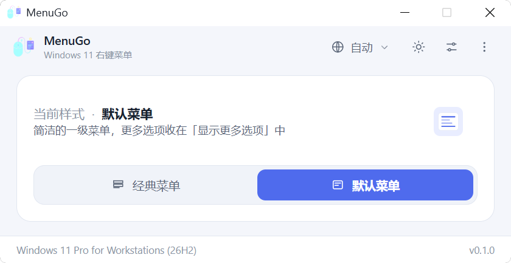
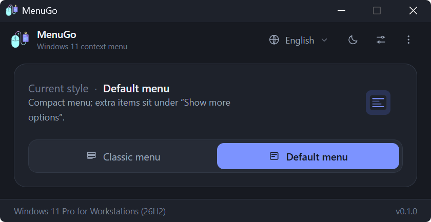

<div align="center">


# MenuGo

**클릭 한 번으로 Windows 11 우클릭 컨텍스트 메뉴를 클래식과 기본 스타일 사이에서 전환합니다.**

[](../LICENSE)
[](https://www.microsoft.com/windows/windows-11)
[](https://tauri.app)
[](https://www.rust-lang.org)
[](../src)
[](https://github.com/zlingxi/MenuGo/releases/latest)
[](https://github.com/zlingxi/MenuGo/stargazers)
[](https://github.com/zlingxi/MenuGo/releases)

[English](../README.md) | [简体中文](README.zh-CN.md) | [繁體中文](README.zh-TW.md) | [日本語](README.ja.md) | **한국어**

</div>

## 스크린샷

| 라이트 | 다크 |
| --- | --- |
|  |  |

## MenuGo를 만든 이유

Windows 11이 새로운 컨텍스트 메뉴와 함께 나온 이후로, 예전의 정보 밀도 높은(Win10 스타일) 메뉴를 되살리는 방법을 다룬 글이 인터넷에 넘쳐납니다: `regedit`에서 레지스트리를 직접 편집하거나, 적당한 블로그에서 주워 온 `.reg` 코드를 붙여 넣거나, 그 외에 무엇을 건드리는지 알 수 없는 무거운 “최적화 도구”를 설치하는 식이죠. 하지만 간단한 질문 하나는 그동안 답하기 쉽지 않았습니다: *이 일 딱 한 가지만 제대로 해 주는 그런 앱은 없을까?*

MenuGo는 바로 그 앱입니다. 원래는 제가 매일 쓰려고 만든 것으로, 딱 한 가지 일만 하는 **가볍고**, **무료**이며 **오픈 소스**인 유틸리티입니다. Windows 11 우클릭 메뉴를 **클래식**과 **기본** 사이에서 클릭 한 번으로 전환하고, 변경 사항이 적용되도록 탐색기를 다시 시작하며, 그 외에는 여러분을 방해하지 않습니다. 저한테는 너무 잘 맞았는지라 조금만 다듬어서 모두와 나누기로 했습니다. **완전 무료, 광고 없음, 추적 없음, 전체 소스 코드 공개.**

## 주요 기능

- 🖱️ 클래식(Win10 스타일)과 Win11 기본 컨텍스트 메뉴를 **클릭 한 번으로 전환** — 현재 상태 *그 자체가* 스위치이며 확인 팝업이 없습니다
- 🖥️ **마우스가 있는 화면에서 실행**——창이 항상 기본 모니터가 아니라 커서가 있는 모니터 중앙에 열립니다
- 🧹 **캐시 지우기 내장**——사용자 디렉터리의 설정·캐시 파일을 한 번에 삭제하며, 사용 중이던 파일은 다음 실행 시 자동으로 정리됩니다
- 🔁 **탐색기 재시작 내장**: 셸을 종료한 뒤 Winlogon이 먼저 복구하길 기다리고, `%WINDIR%\explorer.exe`는 대체 수단으로만 실행하며, 성공을 알리기 전에 바탕화면(`Shell_TrayWnd`)이 실제로 돌아왔는지 확인합니다
- 👥 **모든 사용자에게 적용** (선택 사항, 관리자 권한 필요)
- 🪶 **아주 작은 용량**: 네이티브 Rust 백엔드 + 바닐라 JS 프런트엔드(번들러도 프레임워크도 없음)를 Tauri 2로 패키징했습니다 — exe는 몇 MB에 불과하며, Windows 11이 기본 포함하고 있는 WebView2를 사용합니다
- 🌍 자동 감지 기능이 있는 **10개 인터페이스 언어**: English, 简体中文, 繁體中文, 日本語, 한국어, Deutsch, Français, Español, Русский, Türkçe
- 🌓 라이트 / 다크 / 시스템 설정 따르기 테마, DWM을 통해 **시스템 기본 제목 표시줄 색상까지 동기화**합니다
- 🧳 **포터블 모드**: exe 옆에 빈 `portable.flag` 파일을 놓으면 설정이 그 옆의 `settings.ini`에 저장됩니다 (`%APPDATA%\MenuGo` 대신)
- ⌨️ 스크립트와 자동화를 위한 **명령줄 지원** (`MenuGo.exe /C /R`)
- 🧭 경계 상태를 UI에 바로 보여 줍니다: 권한 상승 안 됨, Windows 11 아님, 작업 표시줄 항상 위 미지원 — 오류 팝업을 해독할 필요 없이 화면에서 바로 확인할 수 있습니다

## 다운로드

[**Releases**](https://github.com/zlingxi/MenuGo/releases) 페이지에서 최신 빌드를 내려받아 실행하기만 하면 됩니다 — 설치 마법사를 따라갈 필요도, 의존성을 설치할 필요도 없습니다.

## 사용법

1. MenuGo를 실행합니다. 현재 적용된 메뉴 스타일이 표시됩니다.
2. **클래식** 또는 **기본**을 클릭해 전환합니다. '재시작 대기' 바가 나타납니다.
3. 바에서 **탐색기 다시 시작**을 클릭하세요 — 또는 빠른 설정 오버레이에서 *전환 후 자동 재시작*을 켜 두면 다시는 신경 쓸 필요가 없습니다.

부가 옵션(모든 사용자에게 적용, 작업 표시줄 자동 숨기기, 작업 표시줄 항상 위, 모양, 언어, 캐시 지우기)은 오른쪽 위 버튼을 누르면 열리는 오버레이에 있고, 정보 / 후원 / 블로그 / GitHub 링크는 아래쪽 도구 모음에 있습니다.

### 키보드 단축키

| 키 | 동작 |
| --- | --- |
| `F5` | 상태 새로 고침 |
| `F1` | 정보 |
| `Esc` | 오버레이 닫기 |
| `Alt+C` / `Alt+D` | 클래식 / 기본으로 전환 |

### 명령줄

```bat
MenuGo.exe /C     :: 클래식 메뉴로 전환
MenuGo.exe /D     :: 기본 메뉴로 전환
MenuGo.exe /R     :: 탐색기 다시 시작 (실패 시 종료 코드 1)
MenuGo.exe /?     :: 도움말
```

조합도 가능합니다. `MenuGo.exe /C /R`은 클래식 메뉴로 전환하면서 탐색기를 한 번에 다시 시작합니다.

## 작동 방식

특별한 비밀은 없습니다. 이 도구가 하는 일은 결국 다음 레지스트리 작업들뿐이므로, 여러분이 직접 모두 확인할 수 있습니다:

| 동작 | 레지스트리 |
| --- | --- |
| 클래식 메뉴 | `HKCU\Software\Classes\CLSID\{86ca1aa0-34aa-4e8b-a509-50c905bae2a2}\InprocServer32` 키를 만들고 기본 `REG_SZ` 값을 비워 둠 |
| 기본 메뉴 | 위의 CLSID 키 삭제 |
| 모든 사용자 | `HKEY_USERS\<SID>\Software\Classes\CLSID\...` 아래에서 같은 작업 수행 (권한 상승 필요) |
| 작업 표시줄 | `HKCU\...\Explorer\StuckRects3\Settings` (`REG_BINARY`, 8번째 바이트 = 자동 숨기기, 12번째 바이트 = 위치) |
| 버전 확인 | Windows 11 = `CurrentBuild >= 22000` (Win11에서도 `ProductName`은 여전히 “Windows 10”이라 표시되므로 사용하지 않음) |

> 참고: 작업 표시줄 위치 옵션은 초기 Windows 11 빌드에서만 동작합니다 — Microsoft가 이후 빌드에서 이 기능을 제거했기 때문입니다. 예전 빌드와의 호환성을 위해 남겨 두었습니다.

## 소스에서 빌드하기

필요한 것: Node.js, Rust 툴체인(`stable-msvc`), Windows 11.

```bash
npm install
npm run dev      # 개발 모드 (tauri dev)
npm run build    # 프로덕션 빌드 (tauri build)
```

일반 브라우저에서 `src/index.html` 파일을 직접 열어 UI를 미리 볼 수도 있습니다 (프런트엔드 전용, 샘플 데이터, 백엔드 없음).

## 프로젝트 구조

```
src/                        프런트엔드 (네이티브 ESM, 번들러 없음)
  index.html                창 마크업 + 인라인 SVG 아이콘
  styles.css                라이트/다크/시스템 테마, 카드, 오버레이, 스위치
  main.js                   상태 조율 및 이벤트 바인딩
  modules/api.js            Tauri IPC 래퍼 + 외부 링크 상수
  modules/i18n.js           언어 사전 + 로캘 판별
  modules/ui.js             렌더링 / 테마 / 오버레이 / 대화상자
src-tauri/
  src/main.rs               CLI 분기 처리 (/C /D /R /?, 창 없음)
  src/lib.rs                AppState + Builder
  src/cli.rs                CLI 파싱
  src/commands.rs           모든 #[tauri::command] 처리기
  src/registry.rs           레지스트리 읽기/쓰기 (단일 접근 지점)
  src/system.rs             탐색기 재시작 / 셸 열기 / 권한 상승 확인
  src/cleanup.rs            사용자 디렉터리 정리(설정 + WebView 캐시)
  src/shell.rs              작업 표시줄 창 탐지 (user32 FFI, 재시작 검증)
  src/titlebar.rs           DWM 제목 표시줄 색상 (dwmapi FFI)
  src/config.rs             INI 설정 저장
  src/models.rs             데이터 전송 객체(DTO)
  tauri.conf.json           고정 560x330 창 (resizable / maximizable = false)
  capabilities/default.json 권한
```

## 참고 사항

- Windows 11(빌드 ≥ 22000)에서만 동작하며, 다른 버전에서는 친절한 안내 메시지가 표시됩니다.
- '모든 사용자에게 적용'은 `HKEY_USERS`에 기록하므로 MenuGo를 관리자 권한으로 실행해야 합니다.
- MenuGo는 [작동 방식](#작동-방식)에 나열된 레지스트리 키만 건드립니다 — 그 외에는 아무것도 건드리지 않습니다.

## 기여하기

버그 보고, 기능 제안, 풀 리퀘스트를 환영합니다! 인터페이스 언어 중 하나를 쓰시다가 어색한 번역을 발견했다면, `src/modules/i18n.js`(또는 docs/ 폴더의 해당 `README.*.md`)를 고쳐 주는 것이 첫 PR로 아주 좋습니다.

## 라이선스

Copyright © 2026 lingxi

이 프로젝트는 [**GNU General Public License v3.0**](../LICENSE)(GPL-3.0) 라이선스에 따라 배포됩니다.

여러분에게 어떤 의미인지 쉽게 풀어 설명하면 다음과 같습니다:

- ✅ **자유로운 사용** — 개인용이든 상업용이든 어떤 목적으로든 사용할 수 있습니다
- ✅ **자유로운 학습과 수정** — 전체 소스 코드가 바로 여기에 있습니다
- ✅ **자유로운 재배포** — 원본이든 여러분이 수정한 버전이든 자유롭게 배포할 수 있습니다
- 📌 MenuGo를 수정해 배포하거나 이 코드를 기반으로 새로운 것을 만들어 공개할 때는 **GPL-3.0으로 전체 소스 코드와 함께 공개해 주세요**. 이는 라이선스의 요청이자 오픈소스 정신을 이어 가는 방법이기도 합니다. 감사합니다!
- 📌 **원본 저작권 표기와 출처를 남겨 주시고**, 무엇을 바꿨는지도 밝혀 주세요. 출처를 밝히는 일은 오픈소스 작성자에게 보낼 수 있는 가장 소박하면서도 확실한 존중입니다. 감사합니다!

전체 라이선스 전문은 [LICENSE](../LICENSE)에 있습니다.

## 제작자

MenuGo는 **lingxi**가 개발했습니다 — [블로그](https://www.aizzx.top) · [후원 ❤](https://www.aizzx.top/sponsor)

MenuGo가 매일 클릭 몇 번을 아껴 준다면, 이 저장소에 별 ⭐ 하나를 눌러 주시는 것이 가장 큰 격려가 됩니다!
