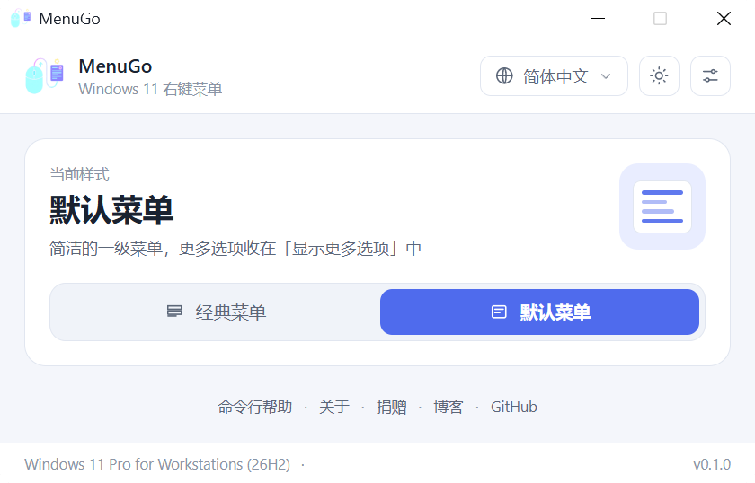
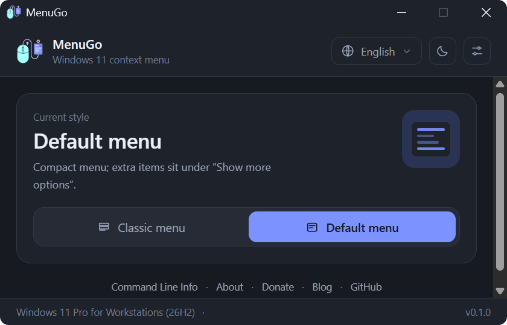

<div align="center">


# MenuGo

**一键在经典与默认的 Windows 11 右键菜单之间切换。**

[](../LICENSE)
[](https://www.microsoft.com/windows/windows-11)
[](https://tauri.app)
[](https://www.rust-lang.org)
[](../src)
[](https://github.com/zlingxi/MenuGo/releases/latest)
[](https://github.com/zlingxi/MenuGo/stargazers)
[](https://github.com/zlingxi/MenuGo/releases)

[English](../README.md) | **简体中文** | [繁體中文](README.zh-TW.md) | [日本語](README.ja.md) | [한국어](README.ko.md)

</div>

## 界面预览

| 浅色 | 深色 |
| --- | --- |
|  |  |

## 为什么选择 MenuGo？

自从 Windows 11 带来了新的右键菜单，网上就到处都是把旧的、信息密度更高的（Win10 风格）菜单找回来的教程：手动打开 `regedit` 改注册表、从不知名的博客里粘贴一段 `.reg` 代码，或者安装一个臃肿的“优化工具箱”，根本说不清它还动了些什么。可是有一个简单的问题，始终没有人好好回答过：*有没有一个正儿八经的小工具，专门就干这件事？*

MenuGo 就是这样的工具。它最初是我为自己日常使用而写的——一个**小巧**、**免费**且**开源**的实用程序，只做一件事：一键把 Windows 11 右键菜单在**经典**与**默认**之间切换、重启资源管理器让改动生效，然后就安静地待在一边，不打扰你。它对我来说实在好用，于是我决定把它打磨一番，分享给大家：**完全免费、无广告、无跟踪，源代码全部公开。**

## 功能亮点

- 🖱️ **一键切换**经典（Win10 风格）与默认 Win11 右键菜单——当前状态*就是*开关，没有确认弹窗
- 🖥️ **跟手启动**——窗口打开在鼠标所在的显示器上，不再固定出现在主屏
- 🧹 **内置「清除缓存」**——一键删除用户目录中的设置与缓存文件，被占用的文件会在下次启动时自动清除
- 🔁 **内置资源管理器重启**：先结束 shell，先等 Winlogon 把它恢复回来，只有在没恢复时才启动 `%WINDIR%\explorer.exe` 作为后备，并在宣布成功之前确认桌面（`Shell_TrayWnd`）真的回来了
- 👥 **应用到所有用户**（可选，需要管理员权限）
- 🪶 **体积小巧**：原生 Rust 后端 + 原生 JS 前端（无打包器、无框架），用 Tauri 2 打包——exe 只有几 MB，使用的还是 Windows 11 自带的 WebView2
- 🌍 **10 种界面语言**，自动检测：English、简体中文、繁體中文、日本語、한국어、Deutsch、Français、Español、Русский、Türkçe
- 🌓 浅色 / 深色 / 跟随系统主题，并通过 DWM 同步**原生标题栏颜色**
- 🧳 **便携模式**：在 exe 旁边放一个空的 `portable.flag`，设置就会保存在它旁边的 `settings.ini` 里（而不是 `%APPDATA%\MenuGo`）
- ⌨️ 支持命令行，方便脚本和自动化（`MenuGo.exe /C /R`）
- 🧭 边界状态直接内建在界面里：未以管理员身份运行、不是 Windows 11、不支持任务栏置顶——你直接看得到，而不用去解读错误弹窗

## 下载

从 [**Releases**](https://github.com/zlingxi/MenuGo/releases) 页面获取最新版本，直接运行即可——不用走安装程序那一套流程，也没有任何依赖要装。

## 使用方法

1. 启动 MenuGo。它会显示当前生效的菜单样式。
2. 点击**经典**或**默认**进行切换。此时会出现一条“待重启”提示栏。
3. 点击提示栏上的**重启资源管理器**——或者在快速设置浮层里开启*切换后自动重启*，从此再也不用惦记这件事。

次要选项（应用到所有用户、自动隐藏任务栏、任务栏置顶、外观、语言、清除缓存）位于右上角按钮背后的浮层里；“关于 / 捐赠 / 博客 / GitHub”链接则在底部工具栏上。

### 键盘快捷键

| 按键 | 功能 |
| --- | --- |
| `F5` | 刷新状态 |
| `F1` | 关于 |
| `Esc` | 关闭浮层 |
| `Alt+C` / `Alt+D` | 切换到经典 / 默认 |

### 命令行

```bat
MenuGo.exe /C     :: 切换到经典菜单
MenuGo.exe /D     :: 切换到默认菜单
MenuGo.exe /R     :: 重启资源管理器（失败时退出码为 1）
MenuGo.exe /?     :: 帮助
```

组合使用：`MenuGo.exe /C /R` 一步完成切换到经典菜单并重启资源管理器。

## 工作原理

没有任何魔法——整个工具归结起来就是下面这几个注册表操作，你可以自己逐一验证：

| 操作 | 注册表 |
| --- | --- |
| 经典菜单 | 创建 `HKCU\Software\Classes\CLSID\{86ca1aa0-34aa-4e8b-a509-50c905bae2a2}\InprocServer32`，默认 `REG_SZ` 值留空 |
| 默认菜单 | 删除上述 CLSID 键 |
| 所有用户 | 在 `HKEY_USERS\<SID>\Software\Classes\CLSID\...` 下执行相同操作（需要提升权限） |
| 任务栏 | `HKCU\...\Explorer\StuckRects3\Settings`（`REG_BINARY`，第 8 字节 = 自动隐藏，第 12 字节 = 位置） |
| 版本检查 | Windows 11 = `CurrentBuild >= 22000`（Win11 上 `ProductName` 仍然写着 "Windows 10"，因此不采用） |

> 注意：任务栏位置选项只在早期的 Windows 11 版本上有效——微软在后来的版本中移除了这项能力。保留它是为了兼容旧版本。

## 从源码构建

环境要求：Node.js、Rust 工具链（`stable-msvc`）、Windows 11。

```bash
npm install
npm run dev      # 开发（tauri dev）
npm run build    # 生产构建（tauri build）
```

你也可以直接用普通浏览器打开 `src/index.html` 预览界面（仅前端、示例数据、无后端）。

## 项目结构

```
src/                        前端（原生 ESM，无打包器）
  index.html                窗口标记 + 内联 SVG 图标
  styles.css                浅色/深色/跟随系统主题、卡片、浮层、开关
  main.js                   状态编排与事件绑定
  modules/api.js            Tauri IPC 封装 + 外部链接常量
  modules/i18n.js           语言字典 + 区域设置解析
  modules/ui.js             渲染 / 主题 / 浮层 / 对话框
src-tauri/
  src/main.rs               CLI 分发（/C /D /R /?，无窗口）
  src/lib.rs                AppState + Builder
  src/cli.rs                CLI 解析
  src/commands.rs           所有 #[tauri::command] 处理函数
  src/registry.rs           注册表读写（唯一访问入口）
  src/system.rs             重启资源管理器 / 打开 shell / 提权检查
  src/cleanup.rs            用户目录清理（设置 + WebView 缓存）
  src/shell.rs              任务栏窗口探测（user32 FFI，重启验证）
  src/titlebar.rs           DWM 标题栏着色（dwmapi FFI）
  src/config.rs             INI 设置持久化
  src/models.rs             DTO
  tauri.conf.json           固定 540x320 窗口（resizable / maximizable = false）
  capabilities/default.json 权限
```

## 注意事项

- 仅支持 Windows 11（内部版本 ≥ 22000）；其他版本会收到一条友好提示。
- “应用到所有用户”会写入 `HKEY_USERS`，需要以管理员身份运行 MenuGo。
- MenuGo 只会触碰[工作原理](#工作原理)中列出的注册表项——其他一概不碰。

## 参与贡献

欢迎提交 Bug 反馈、功能想法和 Pull Request！如果你会其中一种界面语言，发现了别扭的翻译，去 `src/modules/i18n.js`（或 docs/ 里对应的 README）把它修正，会是一个非常好的第一个 PR。

## 许可证

Copyright © 2026 lingxi

本项目基于 [**GNU 通用公共许可证 v3.0**](../LICENSE)（GPL-3.0）授权。

用大白话说，这意味着：

- ✅ **可自由使用**——无论个人还是商业用途
- ✅ **可自由学习和修改**——完整源代码就在这里
- ✅ **可自由再分发**原始版本或你修改后的版本
- 📌 如果你在 MenuGo 的基础上做了修改并分发，或基于此代码构建了新项目，请**同样以 GPL-3.0 发布并附上完整源代码**——这既是协议的要求，也是开源精神得以延续的方式，谢谢你的理解与支持！
- 📌 请**保留原始版权声明与署名**，注明本项目出处，并说明你做了哪些修改。一份清晰的来源标注，是对开源作者最朴素也最珍贵的尊重，谢谢！

完整的法律文本见 [LICENSE](../LICENSE)。

## 作者

MenuGo 由 **lingxi** 开发——[博客](https://www.aizzx.top) · [捐赠 ❤](https://www.aizzx.top/sponsor)

如果 MenuGo 每天为你省下几次点击，给这个仓库点一个 ⭐ 就是最好的鼓励！
