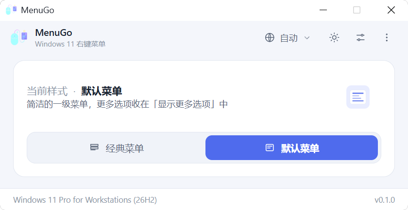
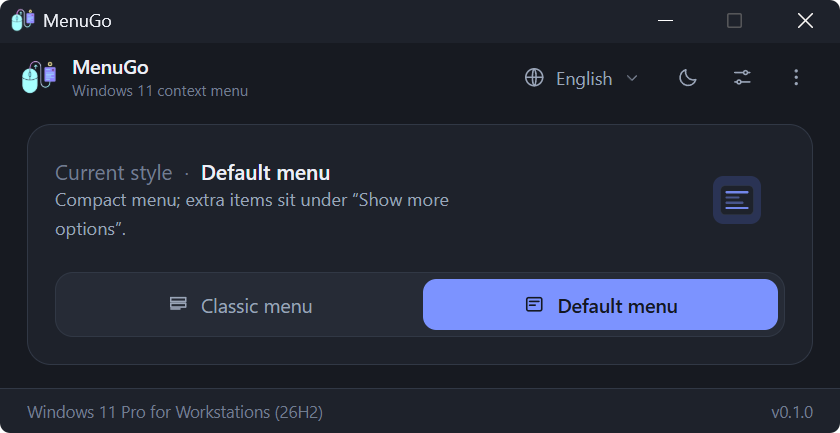

<div align="center">


# MenuGo

**一鍵在傳統與預設的 Windows 11 右鍵快顯功能表之間切換。**

[](../LICENSE)
[](https://www.microsoft.com/windows/windows-11)
[](https://tauri.app)
[](https://www.rust-lang.org)
[](../src)
[](https://github.com/zlingxi/MenuGo/releases/latest)
[](https://github.com/zlingxi/MenuGo/stargazers)
[](https://github.com/zlingxi/MenuGo/releases)

[English](../README.md) | [简体中文](README.zh-CN.md) | **繁體中文** | [日本語](README.ja.md) | [한국어](README.ko.md)

</div>

## 介面預覽

| 淺色 | 深色 |
| --- | --- |
|  |  |

## 為什麼選擇 MenuGo？

自從 Windows 11 換上新的快顯功能表，網路上就滿是把舊的、資訊量更豐富的（Win10 風格）功能表找回來的教學：手動開啟 `regedit` 改登錄檔、從不知名部落格貼上一段 `.reg` 內容，或者安裝一套肥大的「系統調校工具箱」，根本無從得知它還動了哪些東西。但有一個簡單的問題，始終沒有人好好回答過：*有沒有一個正經的小工具，專門就做這一件事？*

MenuGo 就是這樣的工具。它最初是我為自己的日常使用而寫的——一個**小巧**、**免費**且**開放原始碼**的實用程式，只做一件事：一鍵把 Windows 11 右鍵功能表在**傳統**與**預設**之間切換、重新啟動檔案總管讓變更生效，然後就安靜地待在一旁，不打擾你。它實在好用，好用到我決定把它打磨一番，分享給大家：**完全免費、無廣告、無追蹤，原始碼全部公開。**

## 功能亮點

- 🖱️ **一鍵切換**傳統（Win10 風格）與預設 Win11 右鍵快顯功能表——目前狀態*就是*開關，不會跳出確認視窗
- 🖥️ **跟手啟動**——視窗開啟在滑鼠所在的顯示器上，不再固定出現在主螢幕
- 🧹 **內建「清除快取」**——一鍵刪除使用者目錄中的設定與快取檔案，被佔用的檔案會在下次啟動時自動清除
- 🔁 **內建檔案總管重新啟動**：先結束 shell，先等 Winlogon 把它復原，只有在沒有復原時才啟動 `%WINDIR%\explorer.exe` 作為備援，並在宣告成功之前確認桌面（`Shell_TrayWnd`）真的回來了
- 👥 **套用到所有使用者**（選用，需要系統管理員權限）
- 🪶 **體積輕巧**：原生 Rust 後端 + 原生 JS 前端（無打包工具、無框架），以 Tauri 2 封裝——exe 只有幾 MB，使用的還是 Windows 11 內建的 WebView2
- 🌍 **10 種介面語言**，自動偵測：English、简体中文、繁體中文、日本語、한국어、Deutsch、Français、Español、Русский、Türkçe
- 🌓 淺色 / 深色 / 跟隨系統佈景主題，並透過 DWM 同步**原生標題列顏色**
- 🧳 **可攜模式**：在 exe 旁邊放一個空的 `portable.flag`，設定就會保存在它旁邊的 `settings.ini` 裡（而不是 `%APPDATA%\MenuGo`）
- ⌨️ 支援命令列，方便指令碼與自動化（`MenuGo.exe /C /R`）
- 🧭 邊界狀態直接內建在介面裡：未以系統管理員身分執行、不是 Windows 11、不支援工作列最上層顯示——你直接看得到，而不用去解讀錯誤彈窗

## 下載

從 [**Releases**](https://github.com/zlingxi/MenuGo/releases) 頁面取得最新版本，直接執行即可——不必跑安裝程式那一套流程，也沒有任何相依套件要裝。

## 使用方法

1. 啟動 MenuGo。它會顯示目前生效的功能表樣式。
2. 點擊**傳統**或**預設**來切換。此時會出現一條「待重新啟動」提示列。
3. 點擊提示列上的**重新啟動檔案總管**——或者在快速設定面板裡開啟*切換後自動重新啟動*，從此再也不用惦記這件事。

次要選項（套用到所有使用者、自動隱藏工作列、工作列最上層顯示、外觀、語言、清除快取）位於右上角按鈕後方的面板裡；命令列說明與關於，以及 GitHub / 部落格 / 贊助連結，收在右上角的「更多」（⋮）選單裡。

### 鍵盤快速鍵

| 按鍵 | 動作 |
| --- | --- |
| `F5` | 重新整理狀態 |
| `F1` | 關於 |
| `Esc` | 關閉面板 |
| `Alt+C` / `Alt+D` | 切換到傳統 / 預設 |

### 命令列

```bat
MenuGo.exe /C     :: 切換到傳統功能表
MenuGo.exe /D     :: 切換到預設功能表
MenuGo.exe /R     :: 重新啟動檔案總管（失敗時結束代碼為 1）
MenuGo.exe /?     :: 說明
```

組合使用：`MenuGo.exe /C /R` 一步完成切換到傳統功能表並重新啟動檔案總管。

## 運作原理

沒有任何魔法——整個工具其實就歸結為下面這幾項登錄檔操作，你可以自己逐一驗證：

| 動作 | 登錄檔 |
| --- | --- |
| 傳統功能表 | 建立 `HKCU\Software\Classes\CLSID\{86ca1aa0-34aa-4e8b-a509-50c905bae2a2}\InprocServer32`，並將預設 `REG_SZ` 值留空 |
| 預設功能表 | 刪除上述 CLSID 機碼 |
| 所有使用者 | 在 `HKEY_USERS\<SID>\Software\Classes\CLSID\...` 下執行相同操作（需要提升權限） |
| 工作列 | `HKCU\...\Explorer\StuckRects3\Settings`（`REG_BINARY`，第 8 個位元組 = 自動隱藏，第 12 個位元組 = 位置） |
| 版本檢查 | Windows 11 = `CurrentBuild >= 22000`（Win11 的 `ProductName` 仍寫著 "Windows 10"，因此不予採用） |

> 注意：工作列位置選項僅在早期的 Windows 11 組建上有效——微軟已在後續版本移除這項能力。保留此選項是為了相容舊版組建。

## 從原始碼建置

需求：Node.js、Rust 工具鏈（`stable-msvc`）、Windows 11。

```bash
npm install
npm run dev      # 開發（tauri dev）
npm run build    # 正式版建置（tauri build）
```

你也可以直接用一般瀏覽器開啟 `src/index.html` 來預覽介面（僅前端、範例資料、無後端）。

## 專案結構

```
src/                        前端（原生 ESM，無打包工具）
  index.html                視窗標記 + 內嵌 SVG 圖示
  styles.css                淺色/深色/跟隨系統佈景主題、卡片、快顯面板、開關
  main.js                   狀態調度與事件繫結
  modules/api.js            Tauri IPC 封裝 + 外部連結常數
  modules/i18n.js           語言字典 + 地區設定解析
  modules/ui.js             轉譯 / 佈景主題 / 快顯面板 / 對話方塊
src-tauri/
  src/main.rs               CLI 分派（/C /D /R /?，無視窗）
  src/lib.rs                AppState + Builder
  src/cli.rs                CLI 解析
  src/commands.rs           所有 #[tauri::command] 處理常式
  src/registry.rs           登錄檔讀寫（單一存取點）
  src/system.rs             重新啟動檔案總管 / 開啟 shell / 權限提升檢查
  src/cleanup.rs            使用者目錄清理（設定 + WebView 快取）
  src/shell.rs              工作列視窗探測（user32 FFI，重新啟動驗證）
  src/titlebar.rs           DWM 標題列著色（dwmapi FFI）
  src/config.rs             INI 設定持久化
  src/models.rs             DTO
  tauri.conf.json           固定 560x300 視窗（resizable / maximizable = false）
  capabilities/default.json 權限
```

## 注意事項

- 僅支援 Windows 11（組建 ≥ 22000）；其他版本會看到友善提示。
- 「套用到所有使用者」會寫入 `HKEY_USERS`，需要以系統管理員身分執行 MenuGo。
- MenuGo 只會動到[運作原理](#運作原理)中列出的登錄檔機碼——其他一概不碰。

## 參與貢獻

歡迎回報 Bug、提出功能點子或提交 Pull Request！如果你熟悉其中一種介面語言，發現了不太順的翻譯，去 `src/modules/i18n.js`（或 docs/ 裡對應的 README）把它修好，會是很棒的第一個 PR。

## 授權條款

Copyright © 2026 lingxi

本專案以 [**GNU 通用公眾授權條款 v3.0**](../LICENSE)（GPL-3.0）授權。

用白話來說，這對你意味著：

- ✅ **可自由使用**——個人或商業用途皆可
- ✅ **可自由研究與修改**——完整原始碼就在這裡
- ✅ **可自由散布**原始版本或你修改後的版本
- 📌 若你在 MenuGo 的基礎上做了修改並散布，或以此程式碼為基礎打造新專案，請**同樣以 GPL-3.0 授權釋出並附上完整原始碼**——這既是授權條款的要求，也是開源精神得以延續的方式，謝謝你的理解與支持！
- 📌 請**保留原始著作權聲明與署名**，標明本專案出處，並說明你做了哪些變更。一份清楚的來源標註，是對開源作者最樸實也最珍貴的尊重，謝謝！

完整的法律條文見 [LICENSE](../LICENSE)。

## 作者

MenuGo 由 **lingxi** 開發——[部落格](https://www.aizzx.top) · [贊助 ❤](https://www.aizzx.top/sponsor)

如果 MenuGo 每天幫你省下幾次點擊，給這個儲存庫一顆 ⭐ 就是最好的鼓勵！
